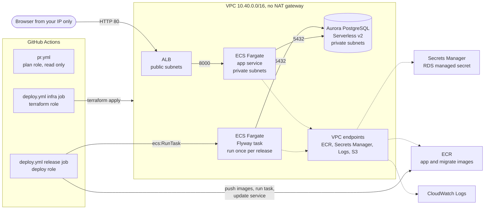

# aurora-fargate-migration-demo

A small but real stack for showing a zero-downtime schema change on AWS:

- Aurora PostgreSQL Serverless v2 (scales to 0 ACU when idle)
- A Python API on ECS Fargate behind an Application Load Balancer
- Everything defined in Terraform
- Schema changes run by Flyway as a one-off ECS task, from the pipeline

The demo itself is one pull request. It adds a `priority` column to `orders`
with an expand-only migration. The app that is already running keeps working,
and the app handles rows where `priority` is NULL.

Nothing here has been applied to an AWS account yet. Read "Before you start"
and "Spin-up order" before running anything.

## Architecture



The private subnets have no route to the internet at all. Tasks reach ECR,
Secrets Manager and CloudWatch Logs through VPC interface endpoints, and pull
image layers through the free S3 gateway endpoint.

## Who owns what

The main idea: Terraform owns infrastructure, Flyway owns the schema. They run
in different jobs, with different IAM roles, and neither can do the other's
job.

| Thing | Owner | How it changes |
|---|---|---|
| VPC, subnets, security groups, endpoints | Terraform | `deploy.yml` infra job |
| Aurora cluster, ALB, ECS cluster, ECR, log groups, budget | Terraform | `deploy.yml` infra job |
| Task definition shape (CPU, memory, env, secrets) | Terraform | `deploy.yml` infra job |
| Which image a task runs | Pipeline | `deploy.yml` release job registers a new revision |
| Tables, columns, constraints, seed data | Flyway | `db/migrations/`, run as an ECS task by the release job |
| DB master password | RDS (Secrets Manager) | Created and rotated by RDS. Nobody types it. |
| GitHub OIDC provider and the three CI roles | `terraform/bootstrap` | Applied once by hand with admin credentials |

### IAM roles

| Role | Used by | Can | Cannot |
|---|---|---|---|
| `migdemo-demo-github-plan` | `pr.yml`, any PR branch in this repo | Read the account, read state | Write anything, read the DB secret |
| `migdemo-demo-github-terraform` | `deploy.yml` infra job, `production-infra` environment | Create and change the stack | Read the DB secret, run ECS tasks, touch the CI roles or OIDC provider |
| `migdemo-demo-github-deploy` | `deploy.yml` release job, `production-app` environment | Push to the two ECR repos, register task definitions, run the migrate task, update the app service | Change infrastructure, read the DB secret |
| app and migrate execution roles | ECS | Pull their own image, write their own logs, read the DB secret to inject it | Anything else |
| app and migrate task roles | Container code | Nothing (no policies attached) | Everything |

The CI roles live in a separate Terraform root (`terraform/bootstrap`) so the
pipeline can never edit its own permissions.

The DB credentials only ever exist inside the running containers. ECS injects
them from Secrets Manager at start-up. They are not in Terraform state, not in
GitHub, not in any file in this repo.

## Expand and contract rules

Every schema change ships in steps, so the code that is running right now
never sees a schema it does not understand.

1. **Expand.** Add things only. New columns are nullable with no default
   rewrite. New constraints go in as `NOT VALID`. Never rename or drop in this
   step. Old code ignores the new column; new code treats NULL as "not set
   yet".
2. **Deploy code** that reads and writes the new column and still handles NULL.
3. **Backfill** old rows in small batches, as its own release.
4. **Contract.** Once no running code depends on the old shape, validate
   constraints, set defaults, add NOT NULL, drop old columns.

Other rules this repo follows:

- Migrations run before the new app version rolls out. That is only safe
  because they are expand-only.
- Each migration sets `lock_timeout` so a blocked `ALTER TABLE` fails fast
  instead of queueing every query behind it.
- Migrations are never edited after they merge. Flyway checksums enforce this.
- `flyway clean` is disabled everywhere.
- The app reads columns by name and never uses `SELECT *`.

`db/migrations/V3__add_order_priority.sql` is the expand step.
`db/future/` holds V4 (backfill) and V5 (enforce) as examples of the next two
releases. Flyway does not read that folder.

## Repo layout

```
.github/workflows/   pr.yml (checks + read-only plan), deploy.yml (apply, migrate, deploy)
terraform/           main stack (network, database, registry, ecs, budget modules)
terraform/bootstrap/ GitHub OIDC provider and the three CI roles, applied once by hand
db/migrations/       Flyway migrations V1 (schema), V2 (seed), V3 (expand)
db/future/           contract steps, not applied
db/Dockerfile        Flyway image with the migrations baked in
app/                 FastAPI app, tests, Dockerfile
scripts/             helpers the release job calls
```

## Before you start

Fill these in. None of them are secrets, but the tfvars and backend files are
gitignored anyway.

| What | Where |
|---|---|
| AWS region | `terraform/terraform.tfvars`, `terraform/bootstrap/terraform.tfvars`, `terraform/backend.hcl`, GitHub var `AWS_REGION` |
| State bucket name | `terraform/backend.hcl`, `terraform/bootstrap/terraform.tfvars`, GitHub var `TF_STATE_BUCKET` |
| GitHub repo (`owner/name`) | `terraform/bootstrap/terraform.tfvars` |
| Budget alert email | `terraform/terraform.tfvars`, GitHub var `BUDGET_EMAIL` |
| Your public IP as a /32 | `terraform/terraform.tfvars`, GitHub var `ALB_INGRESS_CIDRS` (JSON, for example `["203.0.113.10/32"]`) |
| Owner tag | `terraform/terraform.tfvars`, GitHub var `OWNER` |

Also check that the Aurora PostgreSQL version in `terraform/variables.tf`
(`aurora_engine_version`, default `16.9`) is offered in your region. Scaling to
0 ACU needs 16.3 or newer on the 16 line:

```
aws rds describe-db-engine-versions --engine aurora-postgresql \
  --query 'DBEngineVersions[].EngineVersion' --output text
```

Tools: Terraform 1.9 or newer, AWS CLI v2, and an admin profile for the
one-time bootstrap (SSO is best).

## Spin-up order

1. **State bucket** (once, by hand):

   ```
   aws s3api create-bucket --bucket <state-bucket> --region <region>
   # outside us-east-1 also add:
   #   --create-bucket-configuration LocationConstraint=<region>
   aws s3api put-bucket-versioning --bucket <state-bucket> \
     --versioning-configuration Status=Enabled
   aws s3api put-public-access-block --bucket <state-bucket> \
     --public-access-block-configuration \
     BlockPublicAcls=true,IgnorePublicAcls=true,BlockPublicPolicy=true,RestrictPublicBuckets=true
   ```

   New buckets are encrypted with SSE-S3 by default.

2. **Bootstrap the CI roles** with admin credentials:

   ```
   cd terraform
   cp backend.hcl.example backend.hcl                         # fill in
   cp bootstrap/terraform.tfvars.example bootstrap/terraform.tfvars   # fill in
   cd bootstrap
   terraform init -backend-config=../backend.hcl \
     -backend-config="key=aurora-fargate-migration-demo/bootstrap.tfstate"
   terraform plan -out=tfplan
   terraform apply tfplan
   terraform output
   ```

   If the account already has a GitHub OIDC provider, set
   `create_github_oidc_provider = false`.

3. **GitHub setup** (private repo):
   - Repository variables (Settings > Secrets and variables > Actions >
     Variables): `AWS_REGION`, `OWNER`, `BUDGET_EMAIL`, `ALB_INGRESS_CIDRS`,
     `TF_STATE_BUCKET`, and the three role ARNs from step 2 as
     `AWS_PLAN_ROLE_ARN`, `AWS_TERRAFORM_ROLE_ARN`, `AWS_DEPLOY_ROLE_ARN`.
     These are variables, not secrets. No AWS keys are stored in GitHub.
   - Environments: create `production-infra` and `production-app`. On both,
     add yourself as a required reviewer and limit deployment branches to
     `main`. The role trust policies only accept tokens from these
     environments.
   - Branch protection on `main`: require a PR and the `pr` checks.

4. **The demo PR is already staged.** `main` holds V1 and V2 only. The
   `add-order-priority` branch adds `V3__add_order_priority.sql` on top, so
   opening a PR from it is the demo.

5. **First deploy.** `deploy.yml` is manual-only for now, so run it from
   the Actions tab (deploy > Run workflow on `main`). Once you want deploys on
   every merge, add the `push` trigger back at the top of the file. It runs the infra job (about 10 to
   15 minutes, mostly Aurora), then the release job builds the images, runs
   V1 and V2, and starts one app task. The `app_url` output is the address.
   Confirm the budget subscription email AWS sends you.

The ECS service is created with 0 tasks and the bootstrap image tag, because
the images do not exist yet when Terraform first runs. The release job sets
the real image and scales it to 1.

## Demo steps

1. Open the app URL. Orders show, no priority column yet.
2. Push `add-order-priority` and open the PR. Walk through:
   - `pr.yml`: fmt, validate, tflint, checkov, gitleaks, pytest, Docker
     build, and a Terraform plan from the read-only role showing no infra
     change.
   - The `migrations` job runs V1 and V2 against a throwaway Postgres, then V3,
     then checks every existing row has `priority` NULL.
   - The migration itself: nullable column, `NOT VALID` check,
     `lock_timeout`.
3. Merge. Approve `production-infra` (no-op apply), then `production-app`.
4. Watch the release job: Flyway runs V3 in the private subnets, then the app
   rolls. The old task keeps serving during the migration.
5. Refresh the page. The priority column shows `standard (default, NULL in
   DB)` for every row. Nothing broke, no row was rewritten.
6. Talk through `db/future/`: backfill next release, enforce the release after.

Handy checks during the demo:

```
curl http://<app_url>/health        # liveness, no DB
curl http://<app_url>/ready         # opens a DB connection
curl "http://<app_url>/orders?limit=5"
```

The first request after Aurora has paused takes around 15 seconds while it
resumes. `/ready` is a good way to wake it before you start.

## Running locally

```
cd app
python3 -m venv .venv && . .venv/bin/activate
pip install -r requirements.txt -r requirements-dev.txt
pytest
```

The tests use a fake repository and need no database.

To try the migrations against a local Postgres:

```
docker run --rm -d --name pg -e POSTGRES_PASSWORD=local -p 5432:5432 postgres:16
docker build -t demo-migrate db
docker run --rm --network host \
  -e FLYWAY_URL=jdbc:postgresql://localhost:5432/postgres \
  -e FLYWAY_USER=postgres -e FLYWAY_PASSWORD=local demo-migrate migrate
```

## Cost

This is not free tier. Aurora is never free tier. New AWS accounts get
promotional credits, which should cover this several times over, but check the
current offer and your credit balance before relying on it.

Rough us-east-1 numbers while the stack is up:

| Item | Approx. cost |
|---|---|
| Aurora Serverless v2 | about $0.12 per ACU-hour while active, $0 compute when paused (0 ACU after 5 idle minutes), plus storage |
| ALB | about $0.023 per hour plus a little for traffic, plus public IPv4 addresses |
| Fargate, one 0.25 vCPU / 0.5 GB task | about $0.01 per hour |
| 4 interface endpoints, one AZ | about $0.04 per hour (twice that with `single_az_endpoints = false`) |
| RDS managed secret | $0.40 per month, prorated |
| ECR, CloudWatch Logs | cents |

Expect roughly $0.10 to $0.40 an hour depending on how busy the database is.
A day of leaving it up idle is a few dollars. There is no NAT gateway, which
would otherwise be the biggest line item.

The `$10` monthly budget emails at 80% of actual spend and 100% of forecast.
It is account-wide. **A budget only alerts. It does not stop anything.**
Tearing down is the only real cost control.

## Teardown

There is no destroy workflow on purpose. Tear down from your machine with an
admin profile:

```
cd terraform
terraform init -backend-config=backend.hcl
terraform plan -destroy -out=destroy.tfplan
terraform apply destroy.tfplan
```

The ECR repos use `force_delete` and the cluster skips its final snapshot, so
destroy does not get stuck on images or snapshots. Both settings are for this
demo only.

Then, if you are completely done, destroy `terraform/bootstrap` the same way
and delete the state bucket (empty all object versions first).

### Leftovers checklist

Check these in the region after destroy:

- [ ] RDS: no clusters, no instances, no manual snapshots
- [ ] Secrets Manager: no `rds!cluster-...` secret (deleted with the cluster)
- [ ] ECS: no clusters or running tasks
- [ ] EC2 > Load Balancers and Target Groups: empty
- [ ] VPC: the `migdemo-demo` VPC and its endpoints are gone
- [ ] EC2 > Network Interfaces: nothing left from endpoints or tasks
- [ ] EC2 > Elastic IPs: none (this stack creates none, check anyway)
- [ ] ECR: no `migdemo-demo/*` repos
- [ ] CloudWatch Logs: no `/ecs/migdemo-demo/*`, `/aws/rds/cluster/migdemo-demo-*`, or flow log groups
- [ ] IAM: `migdemo-demo-*` roles gone (after bootstrap destroy as well)
- [ ] Budgets: the demo budget is gone, or keep it on purpose
- [ ] S3: state bucket deleted, or kept on purpose
- [ ] Billing > Bills the next day: nothing still accruing

## What production would add

This is sized for a demo, not for real traffic or real data. The gaps, on
purpose:

- **Network egress.** No NAT gateway, so tasks can only reach AWS services
  that have endpoints here. A real service that calls third-party APIs needs a
  NAT gateway per AZ or an egress proxy. Endpoints would also go in every AZ.
- **Availability.** One Aurora writer, no reader, one app task. Production
  wants a reader in a second AZ, at least two tasks across AZs, and a min ACU
  above 0 so nobody waits for a resume.
- **TLS.** The ALB is plain HTTP, limited to one IP. Production needs a domain,
  an ACM certificate, an HTTPS listener with a modern TLS policy, and HTTP
  redirected to HTTPS.
- **WAF** in front of the ALB, with the AWS managed rule groups and rate
  limiting.
- **Database access.** The app uses the master user. Production would have
  separate DB roles: a migration role that owns the schema and an app role with
  only the grants it needs, ideally with IAM auth (already switched on here).
- **Encryption keys.** Everything is encrypted with AWS managed keys. Production
  would use customer managed KMS keys for Aurora, the secret, ECR and logs.
- **Protection and recovery.** Deletion protection, final snapshots, longer
  backup retention, an AWS Backup plan, longer log retention.
- **Observability.** Performance Insights, Container Insights, ALB access logs,
  alarms.
- **CI hardening.** Pin every action to a commit SHA, swap `PowerUserAccess`
  on the terraform role for a hand-written policy, and narrow the read-only
  plan role (`ReadOnlyAccess` can still read things like S3 objects).
- **Release gate.** The deploy role decides what code runs next to the DB
  secret. Code review and the required reviewers on the GitHub environments
  are the real control there.

`.checkov.yaml` lists each skipped check with the reason. They map to the list
above.

## Checks

Run before every push (CI runs the same):

```
terraform -chdir=terraform fmt -check -recursive
terraform -chdir=terraform init -backend=false && terraform -chdir=terraform validate
(cd terraform && tflint --init && tflint --recursive --config "$PWD/.tflint.hcl")
checkov --config-file .checkov.yaml
actionlint
gitleaks git .
(cd app && pytest)
```

`.pre-commit-config.yaml` runs gitleaks and `terraform fmt` on commit if you
use pre-commit.
