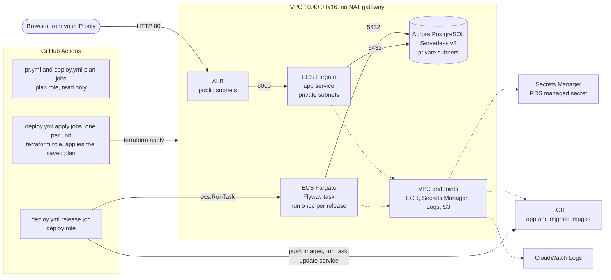

# aurora-fargate-migration-demo

A small AWS stack I use to show a zero-downtime schema change. Aurora
PostgreSQL Serverless v2, a Python API on Fargate behind an ALB, all of it in
Terraform. Flyway runs the migrations as a one-off ECS task from the pipeline.

The demo is one pull request (`add-order-priority`) that adds a `priority`
column to `orders` as an expand-only migration. The running app keeps working
the whole time, and the new code treats NULL as "not set yet".



The private subnets have no route to the internet. Tasks reach ECR, Secrets
Manager and CloudWatch Logs through interface endpoints and pull image layers
through the S3 gateway endpoint. No NAT gateway.

## Who owns what

Terraform owns the infrastructure and Flyway owns the schema. They run in
separate jobs with separate IAM roles, and neither can do the other's job.

| Thing | Owner | How it changes |
|---|---|---|
| VPC, subnets, security groups, endpoints | Terraform, `network` unit | `deploy.yml` network apply job |
| Aurora | Terraform, `data` unit | `deploy.yml` data apply job |
| ALB, ECS cluster, ECR, log groups, budget | Terraform, `app` unit | `deploy.yml` app apply job |
| CloudWatch alarms, alarm topic and its KMS key, dashboard | Terraform, `observability` unit | `deploy.yml` observability apply job |
| Task definition shape (CPU, memory, env, secrets) | Terraform, `app` unit | `deploy.yml` app apply job |
| Which image a task runs | Pipeline | release job registers a new revision |
| Tables, columns, constraints, seed data | Flyway | `db/migrations/`, run by the release job |
| DB master password | RDS | RDS creates and rotates it in Secrets Manager |
| OIDC provider, the three CI roles, the workload boundary | `terraform/bootstrap` | applied by hand |

The CI roles:

| Role | Used by | Can | Can't |
|---|---|---|---|
| `migdemo-testing-github-plan` | `pr.yml`, deploy plan and outputs jobs (`testing-infra-plan` env) | read the account and state, write saved plans under `plans/` in the state bucket | write anything else, read the DB secret |
| `migdemo-testing-github-terraform` | apply jobs, `testing-infra` env | create and change the stack | read the DB secret, run tasks, touch the CI roles, create a role without the workload boundary |
| `migdemo-testing-github-deploy` | release job, `testing-app` env | push to ECR, register task defs, run the migrate task, update the service | change infra, read the DB secret |

The ECS execution roles can pull their own image, write their own logs and
read the DB secret to inject it. The task roles have no policies at all,
since neither container calls AWS.

Every role the Terragrunt units create carries a permissions boundary,
`migdemo-testing-workload-boundary`, which bootstrap owns. It only allows ECR
pulls, writing to the project's log groups and reading the RDS managed secret.
The terraform role can only create or change a `migdemo-testing-*` role if it has
that boundary, can't remove or edit the boundary, and can only pass those
roles to ECS tasks and VPC flow logs. So even if it attached
AdministratorAccess to one of them, that role still couldn't do more than the
boundary allows.

I kept the CI roles in their own Terraform root so the pipeline can't edit its
own permissions. The DB password only exists inside the running containers.
ECS injects it from Secrets Manager at start-up, so it's not in state, not in
GitHub and not in this repo.

## Expand and contract

Schema changes go out in steps so the code that's running never sees a schema
it doesn't understand:

1. Expand: add only. New columns are nullable with no default, new
   constraints go in as `NOT VALID`, nothing gets renamed or dropped. Old code
   ignores the column, new code handles NULL.
2. Ship code that reads and writes the new column.
3. Backfill old rows in small batches, as its own release.
4. Contract: once nothing depends on the old shape, validate constraints, set
   defaults and NOT NULL, drop what's unused.

A few other rules. Migrations run before the new app version rolls out, which
is only safe because they're expand-only. Each one sets `lock_timeout` so a
blocked `ALTER TABLE` fails fast instead of stacking every query up behind
it. Merged migrations are never edited (Flyway's checksums catch it), `flyway
clean` is disabled, and the app selects columns by name, never `SELECT *`.

`db/future/` has V4 (backfill) and V5 (enforce) to show what the next two
releases look like. Flyway doesn't read that folder.

## Layout

```
.github/workflows/      pr.yml (checks + read-only plan), deploy.yml, codeql.yml
.github/dependabot.yml  weekly version bumps
terraform/root.hcl                  remote state, provider and backend for every unit
terraform/layers/{network,data,app,observability} thin root modules, one per unit
terraform/modules/                  the shared modules (network, database, registry, ecs, budget, observability, github_oidc)
terraform/environments/_envcommon/  what each unit is: source, dependencies, mocks, common inputs
terraform/environments/<env>/       env.hcl (sizes, CIDR, region) and one folder per unit
terraform/bootstrap/                OIDC provider and CI roles, plain Terraform, applied by hand
db/migrations/          Flyway migrations
db/future/              contract steps, not applied
db/Dockerfile           Flyway image with the migrations baked in
app/                    FastAPI app, tests, Dockerfile
scripts/                helpers the release job calls
```

## Environments

The stack is split into four Terragrunt units per environment, applied in
order: `network` (VPC, subnets, security groups, endpoints), `data` (Aurora),
`app` (ECR, ALB, ECS, log groups, budget) and `observability` (alarms, the
alarm topic, a dashboard). Each unit has its own state at
`aurora-fargate-migration-demo/<env>/<unit>/terraform.tfstate` in the state
bucket. The per-env folders only pick sizes; all the Terraform lives in
`terraform/layers` and `terraform/modules`.

| Env | Status |
|---|---|
| `testing` | Deployed by `deploy.yml` (not deployed yet under this layout, see below). Same sizes as the original demo: one AZ for the endpoints, Aurora 0 to 2 ACU with auto-pause, 2 app tasks. |
| `stage` | Not deployed. `env.hcl` only, checked in CI against mock outputs. |
| `production` | Not deployed. `env.hcl` only, checked in CI against mock outputs. |

Deploying stage or production would need its own state bucket, a bootstrap
apply with that `environment`, its three GitHub environments, and the env
added to the `deploy.yml` choice list. The budget is account wide, so two envs
in one account would each create one.

Where things stand: the single-env stack was deployed to us-east-2 through
the deploy workflow on 2026-10-24 and torn down the same weekend, with
bootstrap kept. Since the Terragrunt refactor (PR #4) only bootstrap has been
re-applied. The testing env hasn't been deployed under the new layout yet.

Before Terragrunt, the whole stack lived in one root with its state at
`aurora-fargate-migration-demo/terraform.tfstate`. That stack was destroyed
before the move, so nothing was migrated and nothing reads that key any more.
The bootstrap state key did not change.

## Setup

You need Terraform 1.11+, Terragrunt 1.2.1 (what CI pins), AWS CLI v2 and
admin credentials for the one-time bootstrap. None of these values are
secrets, but the tfvars and backend files are gitignored anyway.

| Value | Goes in |
|---|---|
| Region | `aws_region` in `environments/<env>/env.hcl`, `bootstrap/terraform.tfvars`, var `AWS_REGION`. All three must match. |
| State bucket | `backend.hcl` (bootstrap only), `bootstrap/terraform.tfvars`, var `TF_STATE_BUCKET`, or `TF_STATE_BUCKET` in your shell for local Terragrunt runs |
| GitHub repo (`owner/name`) | `bootstrap/terraform.tfvars` |
| Budget email | var `BUDGET_EMAIL`, or `MIGDEMO_BUDGET_EMAIL` in your shell |
| Your IP as a /32 | var `ALB_INGRESS_CIDRS`, or `MIGDEMO_ALB_INGRESS_CIDRS` in your shell (JSON, e.g. `["203.0.113.10/32"]`) |
| Owner tag | var `OWNER`, or `MIGDEMO_OWNER` in your shell |

Check that the Aurora version (`aurora_engine_version` in
`terraform/environments/<env>/env.hcl`, `16.9` in testing) is offered in your region. Scale to
zero needs 16.3 or newer on the 16 line.

```
aws rds describe-db-engine-versions --engine aurora-postgresql \
  --query 'DBEngineVersions[].EngineVersion' --output text
```

### 1. State bucket

Once, by hand. New buckets get SSE-S3 by default.

```
aws s3api create-bucket --bucket <state-bucket> --region <region>
# outside us-east-1, also pass:
#   --create-bucket-configuration LocationConstraint=<region>
aws s3api put-bucket-versioning --bucket <state-bucket> \
  --versioning-configuration Status=Enabled
aws s3api put-public-access-block --bucket <state-bucket> \
  --public-access-block-configuration \
  BlockPublicAcls=true,IgnorePublicAcls=true,BlockPublicPolicy=true,RestrictPublicBuckets=true
```

### 2. Bootstrap the CI roles

Run this locally with admin credentials. It's the only Terraform that doesn't
go through the pipeline. Re-run it whenever `terraform/bootstrap` or
`modules/github_oidc` changes, and before the next deploy, since the
Terragrunt units expect the boundary policy to exist. Set `aws_region` in
`bootstrap/terraform.tfvars` to the region in `environments/testing/env.hcl`.

```
cd terraform
cp backend.hcl.example backend.hcl                                # fill in
cp bootstrap/terraform.tfvars.example bootstrap/terraform.tfvars  # fill in
cd bootstrap
terraform init -backend-config=../backend.hcl \
  -backend-config="key=aurora-fargate-migration-demo/bootstrap.tfstate"
terraform plan -out=tfplan
terraform apply tfplan
terraform output
```

If the account already has a GitHub OIDC provider, set
`create_github_oidc_provider = false`. If the plan job fails with "Not
authorized to perform sts:AssumeRoleWithWebIdentity", GitHub is sending the
immutable subject format; see the comment in `bootstrap/terraform.tfvars.example`.

### 3. GitHub

- Repo variables (Settings > Secrets and variables > Actions > Variables): the
  ones in the table above, plus the three role ARNs from step 2 as
  `AWS_PLAN_ROLE_ARN`, `AWS_TERRAFORM_ROLE_ARN` and `AWS_DEPLOY_ROLE_ARN`.
  No AWS keys go in GitHub.
- Environments `testing-infra` and `testing-app`, each with a required
  reviewer and deployments limited to `main`. The role trust policies only
  accept tokens from these environments.
- Environment `testing-infra-plan`, deployments limited to `main`, no
  reviewer. The deploy plan and outputs jobs use it to get the plan role.
- Branch protection on `main`: require a PR and the `pr` checks.

### 4. First deploy

`deploy.yml` is manual for now. Run it from the Actions tab on `main` and
pick the env (only `testing` is offered). It goes one unit at a time:
network, then data, then app, then observability (which runs alongside the
release, so the release never waits on it). For each unit the plan job runs first, against
the real outputs of the units before it. Its summary shows the plan, and the
readable plan is also uploaded as the `terraform-plan-<env>-<unit>` artifact
(kept 5 days). Read it before you approve `testing-infra`. The apply job then
applies that exact saved plan, not a new one. If anything changed the state
in between, the apply fails and you run deploy again. A unit with no changes
skips its apply, so a run asks for between zero and four infra approvals.
Every apply also waits for the image scan.

Why not one `terragrunt run --all plan` up front: data and app would be
planned before network exists, so their plans would be built on mock outputs
and couldn't be applied as reviewed. Planning each unit right after the one
before it is applied keeps every saved plan exact.

The binary plan goes to `plans/<run>/<env>/<unit>/tfplan` in the state
bucket, not the artifact, because this repo is public and a binary plan can
hold real values. The artifact has its sha256, and the apply job refuses to
apply a file that doesn't match.

The data apply takes 10 to 15 minutes (Aurora), then the release job
pushes the images, runs the migrations and starts two app tasks, one in each
AZ. The run summary
prints the app URL. AWS sends two subscription emails to the budget address,
one for the budget and one for the alarm topic. Click the link in the alarm
one or no alarm email is ever delivered (see Monitoring).

Terraform creates the ECS service with 0 tasks and a placeholder image tag,
since the images don't exist yet on the first run. The release job sets the
real image and scales it to 2. To deploy on every merge instead, add a `push`
trigger for `main` at the top of `deploy.yml`.

## Running the demo

1. Open the app URL. Orders show, no priority yet.
2. Open a PR from `add-order-priority`. In the checks, the plan shows no infra
   change, and the Flyway job runs V1 and V2 against a throwaway Postgres,
   then V3, then confirms every existing row still has `priority` NULL. Walk
   through the migration itself: nullable column, `NOT VALID` check,
   `lock_timeout`.
3. Merge, run deploy, check the four plans in the run summary (no changes,
   so no infra approval is asked for), then approve `testing-app`.
4. Flyway runs V3 in the private subnets, then the app rolls. The old tasks
   keep serving until the new ones are healthy.
5. Refresh. Every row shows `standard (default, NULL in DB)`. Nothing was
   rewritten.
6. Talk through `db/future/`: backfill next release, enforce the one after.

```
curl http://<app_url>/health        # liveness, no DB
curl http://<app_url>/ready         # opens a DB connection
curl "http://<app_url>/orders?limit=5"
```

If Aurora has paused, the first request takes about 15 seconds. Hit `/ready`
before you start to wake it up.

## Running locally

```
cd app
python3 -m venv .venv && . .venv/bin/activate
pip install -r requirements.txt -r requirements-dev.txt
pytest
```

The tests use a fake repository, no database needed. To try the migrations
against a local Postgres:

```
docker run --rm -d --name pg -e POSTGRES_PASSWORD=local -p 5432:5432 postgres:16
docker build -t demo-migrate db
docker run --rm --network host \
  -e FLYWAY_URL=jdbc:postgresql://localhost:5432/postgres \
  -e FLYWAY_USER=postgres -e FLYWAY_PASSWORD=local demo-migrate migrate
```

## Monitoring

The `observability` unit adds eleven CloudWatch alarms, one SNS topic they
all send to, and a dashboard called `migdemo-testing` (CloudWatch >
Dashboards). Every alarm emails on ALARM and again on OK, so you get a
"recovered" mail too. Thresholds are inputs; the defaults in
`terraform/modules/observability/variables.tf` suit testing, and
`alarm_thresholds` in `env.hcl` overrides any of them per env.

The email goes to the budget address (`BUDGET_EMAIL`). After the first
observability apply, AWS sends an "AWS Notification - Subscription
Confirmation" email. Click the link in it. Until you do, the subscription
stays "Pending confirmation" and nothing is delivered. Terraform can't
confirm it for you. SNS deletes an unconfirmed email subscription after 48
hours. If that happens, re-run deploy: the observability plan sees the
subscription is gone and creates it again, which sends a new email.

| Alarm (`migdemo-testing-...`) | Fires when (testing default) | What to do |
|---|---|---|
| `alb-5xx` | the ALB itself returns 5 or more 5xx in 5 minutes | Usually no healthy target (502/503) or a timeout (504). Check the target group health and the ECS service events. |
| `target-5xx` | the app returns 5 or more 5xx in 5 minutes | Read the app log group `/ecs/migdemo-testing/app`. If it's DB errors, check whether Aurora is resuming or out of connections. |
| `unhealthy-hosts` | any target fails `/health` for 2 of 3 minutes | Look at the target group's health reasons and the stopped tasks' reasons in ECS. A bad image or a crash loop shows up here first. |
| `healthy-hosts-low` | fewer healthy targets than the service's desired count (2) for 3 minutes | Same as above. Also fires when there are no tasks at all. |
| `ecs-tasks-low` | fewer live tasks than desired (2) for 3 minutes | Check ECS service events for placement or image pull errors. Expected when the service is at 0, see below. |
| `ecs-cpu-high` | service CPU above 80% for 10 minutes | Real load or a hot loop. Raise the task CPU in `modules/ecs` or the task count. |
| `ecs-memory-high` | service memory above 80% for 10 minutes | Watch for OOM kills in stopped task reasons. Raise task memory if it's real use. |
| `aurora-cpu-high` | Aurora CPU above 80% for 10 minutes | On Serverless v2 this is a percent of the CPU at max ACU, so the cluster is close to its ceiling. Find the heavy query, or raise `aurora_max_capacity`. |
| `aurora-acu-high` | Aurora above 90% of max ACU for 15 minutes | It can't scale any further. Raise `aurora_max_capacity` if the load is expected. |
| `aurora-freeable-memory-low` | Aurora freeable memory under 256 MiB for 10 minutes | Only happens at max ACU, since Serverless v2 scales up before memory gets tight. Same fix as ACU. |
| `aurora-connections-high` | more than 100 open connections for 10 minutes | The app opens one short connection per request, so this means a leak or a traffic spike. Max 2 ACU allows roughly 400. |

Missing data: no 5xx data means no 5xx, and when Aurora auto-pauses it stops
reporting memory and connections, so those count as fine. No task or healthy
host data means no tasks are running, so those two count as breaching.

Expected noise:

- Terraform creates the ECS service with 0 tasks and the release scales it
  up, so on the first deploy `ecs-tasks-low` and `healthy-hosts-low` go to
  ALARM until the release finishes, then send OK. The same happens any time
  the service is scaled to 0 on purpose.
- A release that rolls the tasks can briefly trip `unhealthy-hosts`. It needs
  2 bad minutes out of 3, which a normal roll doesn't hit.
- Waking a paused Aurora takes about 15 seconds. If several requests in that
  window fail, `target-5xx` can fire once and clear on the next 5 minutes.

The topic is encrypted with its own KMS key (`alias/migdemo-testing-alarms`)
rather than the AWS managed `alias/aws/sns` key. CloudWatch alarms can't
publish to a topic that uses the AWS managed key, because its key policy
can't be changed to let CloudWatch use it, and the alarm just fails to
deliver. The custom key's policy lets CloudWatch encrypt messages, and the
topic policy only accepts publishes from `migdemo-testing-*` alarms in this
account.

ECS task count uses `LiveTaskCount` from the standard `AWS/ECS` metrics, so
Container Insights stays off (it would bill per metric per task).

## Cost

Not free tier (Aurora never is). New account credits cover it easily, but
check your balance. Rough us-east-2 numbers while it's up:

| Item | Approx. |
|---|---|
| Aurora Serverless v2 | ~$0.12 per ACU-hour when active, $0 compute when paused (after 5 idle minutes), plus storage |
| ALB | ~$0.023/hour plus traffic and public IPv4 |
| Fargate, two 0.25 vCPU / 0.5 GB tasks | ~$0.02/hour |
| 4 interface endpoints, one AZ | ~$0.04/hour (double with `single_az_endpoints = false`) |
| RDS managed secret | $0.40/month, prorated |
| ECR, CloudWatch Logs | cents |
| 11 CloudWatch alarms | ~$0.10 each a month, prorated. The first 10 in the account are free tier, so ~$0.10 to $1.10/month |
| CloudWatch dashboard | free if it's one of the account's first 3, otherwise $3/month |
| KMS key for the alarm topic | $1/month prorated hourly, nothing once scheduled for deletion |
| SNS email | first 1,000 emails a month free |

Call it $0.10 to $0.40 an hour depending on how busy the DB is, or a few
dollars for a day left idle. Skipping the NAT gateway is what keeps it this
low.

The $10 monthly budget emails at 80% of actual and 100% of forecast, account
wide. It only alerts, it doesn't stop anything. Tearing down is the real cost
control.

## Teardown

There's no destroy workflow, on purpose. From your machine with admin
credentials:

```
export TF_STATE_BUCKET=<state-bucket> TF_STATE_REGION=<bucket-region>
export MIGDEMO_OWNER=<owner> MIGDEMO_BUDGET_EMAIL=<email>
export MIGDEMO_ALB_INGRESS_CIDRS='["203.0.113.10/32"]'
export MIGDEMO_MOCKS_ON_PLAN=false
cd terraform/environments/testing
# Reverse order: observability, then app, then data, then network. In Git
# Bash, pwd -W gives a Windows path that terraform.exe understands.
for unit in observability app data network; do
  terragrunt run --working-dir "$unit" -- plan -destroy -out="$(pwd -W)/$unit.destroy.tfplan"
  terragrunt run --working-dir "$unit" -- apply "$(pwd -W)/$unit.destroy.tfplan"
  rm "$unit.destroy.tfplan"
done
```

Each plan is shown before its apply, and Terraform asks nothing more for a
saved plan, so stop the loop (Ctrl+C) if a plan looks wrong.

ECR repos use `force_delete` and the cluster skips its final snapshot so
destroy doesn't hang on either. Both are demo-only settings. If you're done for
good, destroy `terraform/bootstrap` with plain `terraform plan -destroy` and
`terraform apply` from that folder, then delete the state bucket
(empty all object versions first).

Things to check in the region afterwards:

- [ ] RDS: no clusters, no instances, no manual snapshots
- [ ] Secrets Manager: no `rds!cluster-...` secret (deleted with the cluster)
- [ ] ECS: no clusters or running tasks
- [ ] EC2 > Load Balancers and Target Groups: empty
- [ ] VPC: the `migdemo-testing` VPC and its endpoints are gone
- [ ] EC2 > Network Interfaces: nothing left from endpoints or tasks
- [ ] EC2 > Elastic IPs: none (this stack creates none, check anyway)
- [ ] ECR: no `migdemo-testing/*` repos
- [ ] CloudWatch Logs: no `/ecs/migdemo-testing/*`, `/aws/rds/cluster/migdemo-testing-*`, or flow log groups
- [ ] CloudWatch: no `migdemo-testing-*` alarms, no `migdemo-testing` dashboard
- [ ] SNS: no `migdemo-testing-alarms` topic or subscription
- [ ] KMS: the `migdemo-testing alarm topic` key shows "Pending deletion" (7 days, no charge while pending)
- [ ] IAM: `migdemo-testing-*` roles gone (after bootstrap destroy as well)
- [ ] Budgets: the demo budget is gone, or keep it on purpose
- [ ] S3: state bucket deleted, or kept on purpose
- [ ] Billing > Bills the next day: nothing still accruing

## Security checks

Every PR to `main` runs:

- `terraform fmt`, `validate` on bootstrap and each layer, `tflint`,
  `terragrunt hcl fmt` and `terragrunt hcl validate --inputs --strict` across
  every env, then a testing plan of each unit from the read-only role posted
  as a PR comment. Units whose dependencies aren't applied yet are planned
  against mock outputs, so that plan is for review only.
- Checkov on the Terraform. Skipped checks are listed with reasons in
  `.checkov.yaml`
- Gitleaks over the full git history, not just the diff
- Bandit (fails on medium or higher) and CodeQL on the app, plus CodeQL on the
  workflow files. CodeQL also runs on `main` and weekly
- pip-audit on the pinned Python packages
- Trivy on both images, built on the runner and never pushed. Fails on any
  fixable HIGH or CRITICAL, results go to the Security tab
- The Flyway migration test and pytest

Only the plan job uses AWS credentials, and it's skipped on fork PRs since
they don't get an OIDC token.

The deploy workflow scans both images again before pushing to ECR. A fixable
CRITICAL stops the release, and what gets pushed is the exact image that was
scanned. Dependabot watches the Python pins, both Dockerfiles, the Actions
and the Terraform providers.

Dependabot bumps the lock files in `terraform/layers` and `terraform/modules`,
but the ones Terragrunt actually uses are committed in each unit folder under
`terraform/environments`. All twelve are the same file. After a provider bump:

```
cd terraform/layers/network
terraform init -backend=false -upgrade
terraform providers lock -platform=linux_amd64 -platform=windows_amd64 -platform=darwin_arm64
for d in ../../environments/*/*/; do cp .terraform.lock.hcl "$d"; done
```

Trivy's action is pinned to a commit SHA rather than a tag because its tags
were hijacked in March 2026 to steal CI secrets (GHSA-69fq-xp46-6x23).
`hashicorp/setup-terraform` and `aws-actions/configure-aws-credentials` are
pinned the same way, since they install Terraform and hand out AWS
credentials. The version is in a comment next to each SHA so Dependabot can
still bump them. The other actions are still on major tags.

To run the same checks locally:

```
terraform -chdir=terraform fmt -check -recursive
for d in bootstrap layers/network layers/data layers/app layers/observability; do
  terraform -chdir="terraform/$d" init -backend=false && terraform -chdir="terraform/$d" validate
done
(cd terraform && tflint --init && tflint --recursive --config "$PWD/.tflint.hcl")
(cd terraform && terragrunt hcl fmt --check)
(cd terraform/environments && MIGDEMO_OWNER=x MIGDEMO_BUDGET_EMAIL=x@example.com \
  MIGDEMO_ALB_INGRESS_CIDRS='["203.0.113.10/32"]' \
  terragrunt hcl validate --inputs --strict && terragrunt list --dag --tree)
checkov --config-file .checkov.yaml
actionlint
gitleaks git .
(cd app && pytest)
bandit -r app --exclude app/tests,app/.venv --severity-level medium --confidence-level medium
pip-audit -r app/requirements.txt -r app/requirements-dev.txt
```

`.pre-commit-config.yaml` runs gitleaks and `terraform fmt` on commit if you use
pre-commit.

## What I'd add for production

This is sized for a demo with fake data. The gaps are deliberate:

- A NAT gateway or egress proxy per AZ if the app ever calls outside APIs, and
  endpoints in every AZ.
- An Aurora reader in a second AZ and min ACU above 0 so nobody waits on a
  resume. The app already runs a task in each AZ, but with the default
  `single_az_endpoints = true` the endpoints only live in the first AZ, so the
  second AZ's task still depends on it.
- HTTPS: a domain, an ACM cert, a modern TLS policy, HTTP redirected. WAF in
  front with the managed rule groups and rate limiting.
- Separate DB roles: one that owns the schema for migrations and one for the
  app with only the grants it needs, ideally with IAM auth (already turned on).
- Customer managed KMS keys for Aurora, the secret, ECR and logs.
- Deletion protection, final snapshots, longer backup and log retention, an
  AWS Backup plan.
- Performance Insights, Container Insights and ALB access logs. The alarms
  email one inbox; production would page someone (PagerDuty, Opsgenie or
  similar) and add an alarm on the 5xx rate rather than a count.
- The rest of the actions pinned to SHAs, a policy generated from CloudTrail instead of
  `PowerUserAccess` on the terraform role (IAM is already scoped and bounded),
  and a narrower plan role (`ReadOnlyAccess` can still read S3 objects).

The deploy role decides what code runs next to the DB secret, so code review
and the environment reviewers are the real control on releases. The skips in
`.checkov.yaml` line up with this list.
